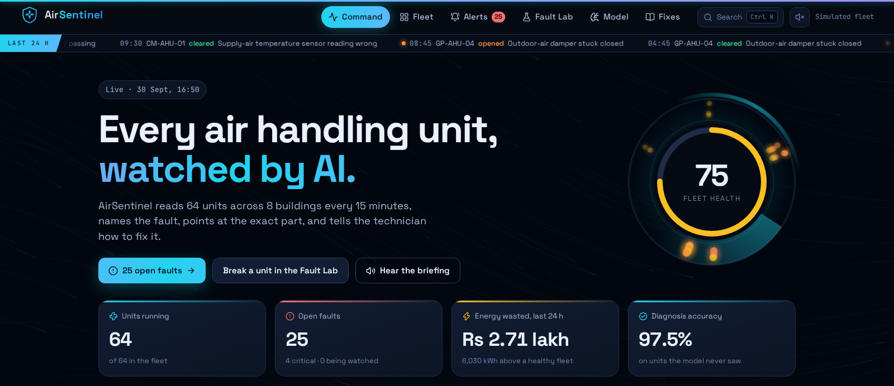
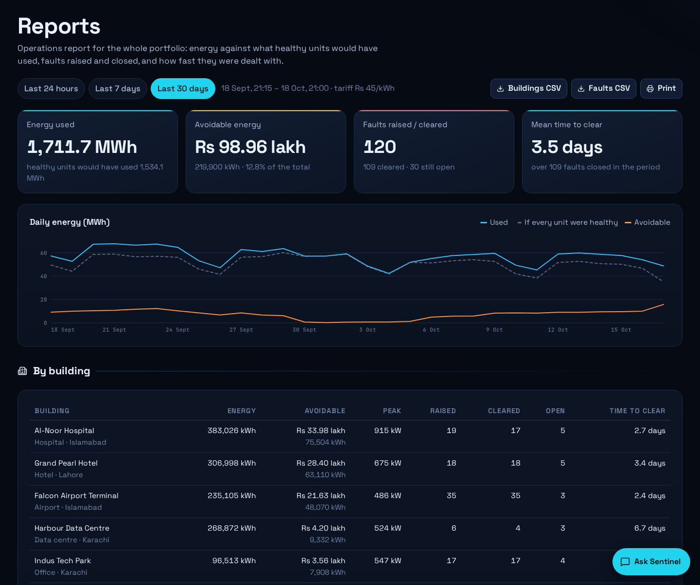
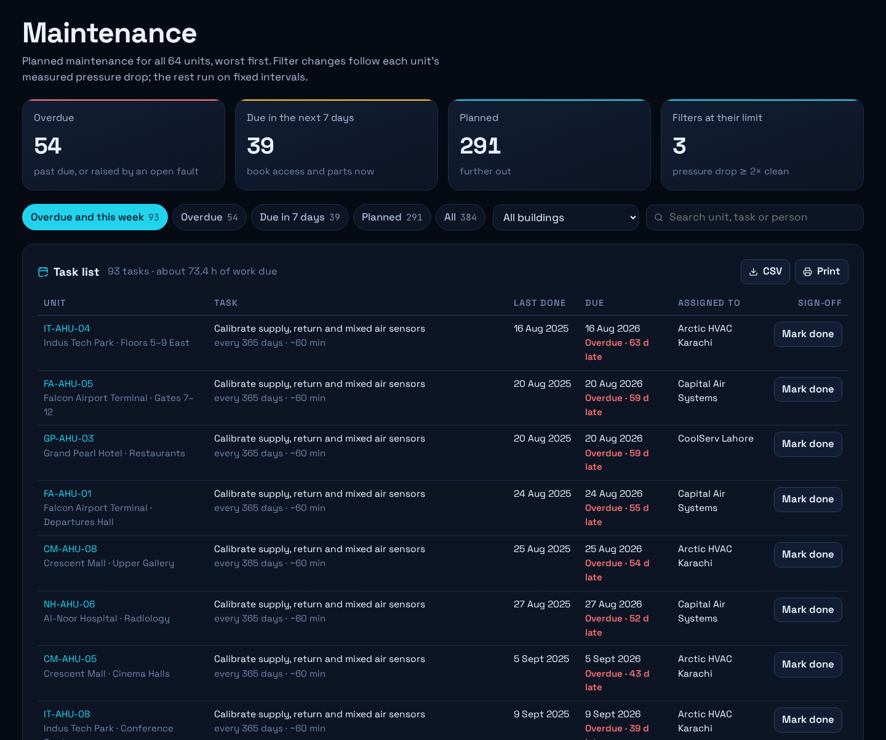
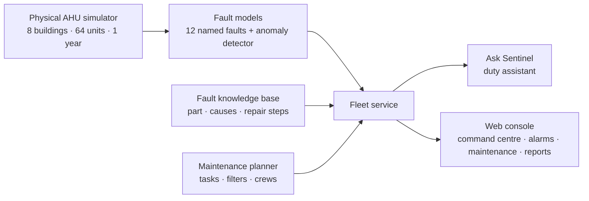

# AirSentinel

Fault detection for air handling units (AHUs). AirSentinel reads every unit in a fleet of
buildings, names the fault, points at the part that has failed, and gives the technician the
repair steps.

**Live:** https://airsentinel.twinstackstudio.com

## What it does

- **Diagnosis** — a trained model names one of 12 faults from a unit's readings: stuck
  dampers, passing or stuck valves, fouled coil, clogged filter, slipping fan belt, duct
  leakage, drifted sensors. A second detector flags behaviour that is unusual without a name.
- **Where and how to fix it** — each fault maps to a part on an animated schematic of the
  unit, with symptoms, likely causes, repair steps, tools and time.
- **Alarm handling** — acknowledge an alarm, assign it to the site technician or the
  contractor, mark when work starts and keep a running log of notes on it.
- **Planned maintenance** — six routine tasks per unit (filters, drain pans, belts and
  bearings, dampers, coils, sensor calibration) with last-done and due dates, who does
  each one, sign-off, CSV export and a printable task list. Filter changes follow each
  unit's measured pressure drop, corrected to design airflow.
- **Operations reports** — the last 24 hours, 7 days or 30 days: energy used against what
  healthy units would have used, avoidable cost in rupees, faults raised and cleared, mean
  time to clear, a breakdown by building, the units that wasted the most, and the fault
  log, with CSV export and print.
- **Command centre** — fleet health, the fleet drawn as a city (one floor per unit), a live
  counter of the money open faults are burning, early warnings, and a time machine that
  replays the last seven days.
- **Ask Sentinel** — a duty assistant that answers any question in English, Urdu or Roman
  Urdu ("what is wrong with NH 8?", "which maintenance is overdue at Crescent Mall?",
  "filter kab change karna chahiye?"). Every figure it quotes comes from the live fleet.
- **Fault Lab** — break a unit on purpose and watch the model find it.
- **Work orders** — a printable job card for any open fault, and a 48-hour readings
  export for every unit.
- Command palette (Ctrl+K), spoken briefing, alert chimes, the unit's fan as sound. The
  layout and type scale smoothly from a 320 px phone to a 2560 px screen.

## The data, honestly

There is no public dataset of a city's AHUs with their faults labelled, so the fleet is
**simulated**: 8 buildings, 64 units, one year of readings every 15 minutes (2.24 million
rows) with 928 fault episodes. Each unit is a physical model (mixing box, filter, coils,
fan, duct, zones) under real control sequences; a fault is injected where it physically
happens and the controls react to it.

Scores are measured only on units the model never saw (4-fold, grouped by unit):

| Measure | Result |
| --- | --- |
| Single readings named correctly | 97.8% |
| 3-hour diagnoses named correctly | 97.5% |
| Fault episodes named correctly | 96.4% |
| False alarms on healthy readings | 0.41% |
| Anomaly detector AUC | 0.951 |

These numbers describe the simulated fleet. A real building would need its own history
before they could be trusted.

## Architecture

## Source code

This is the public showcase. The source code is kept in a private repository. Try the live demo above, and [contact TwinStack Studio](https://twinstackstudio.com/contact) for a walkthrough or a similar project.

© 2026 TwinStack Studio. All rights reserved. See [LICENSE](./LICENSE).
